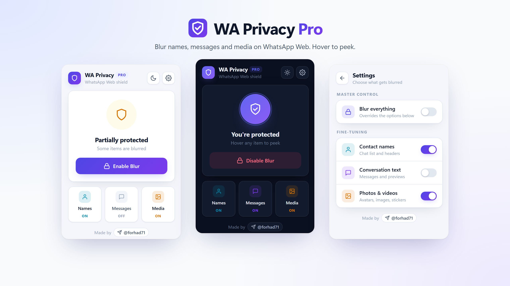
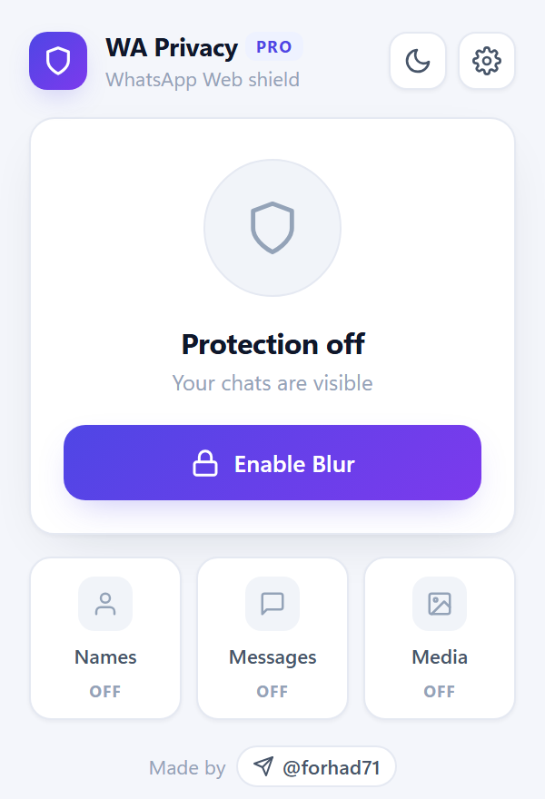
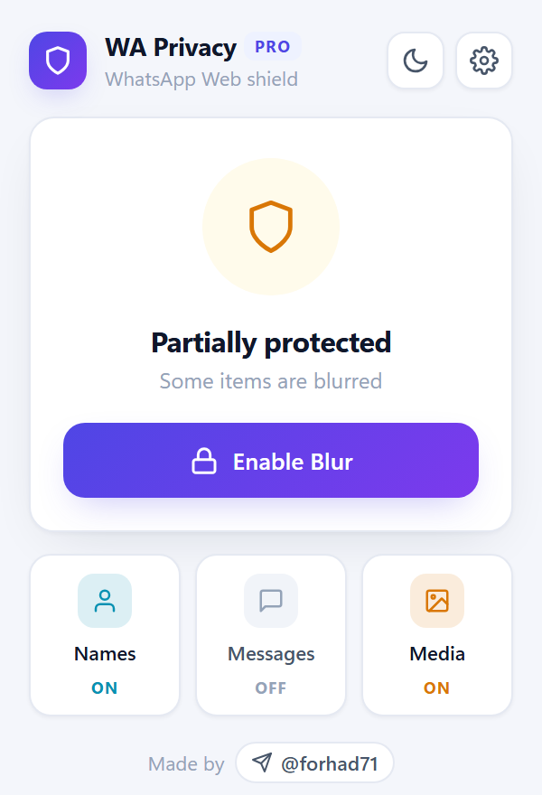
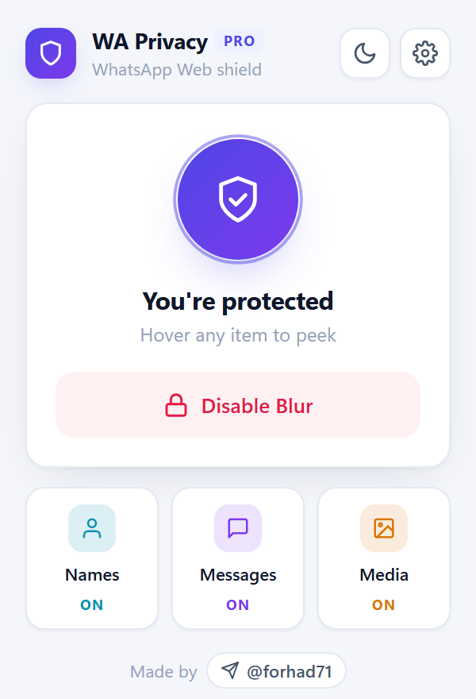
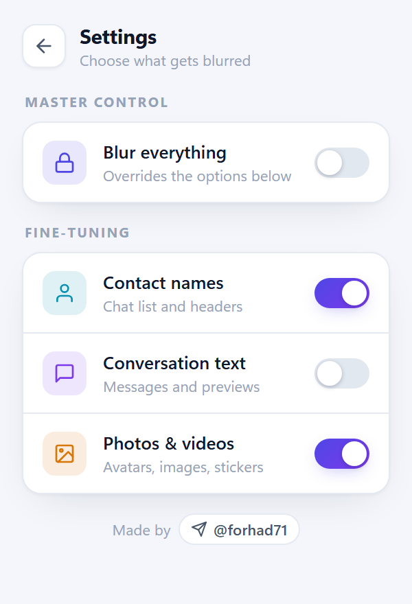
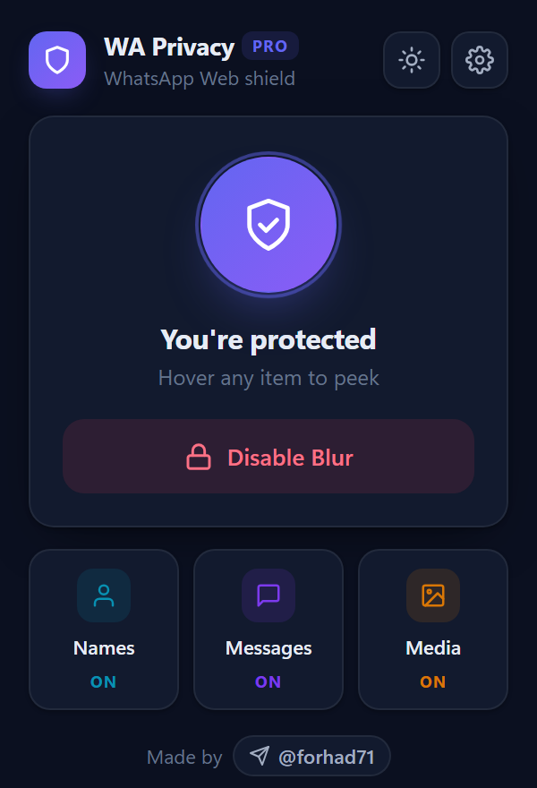
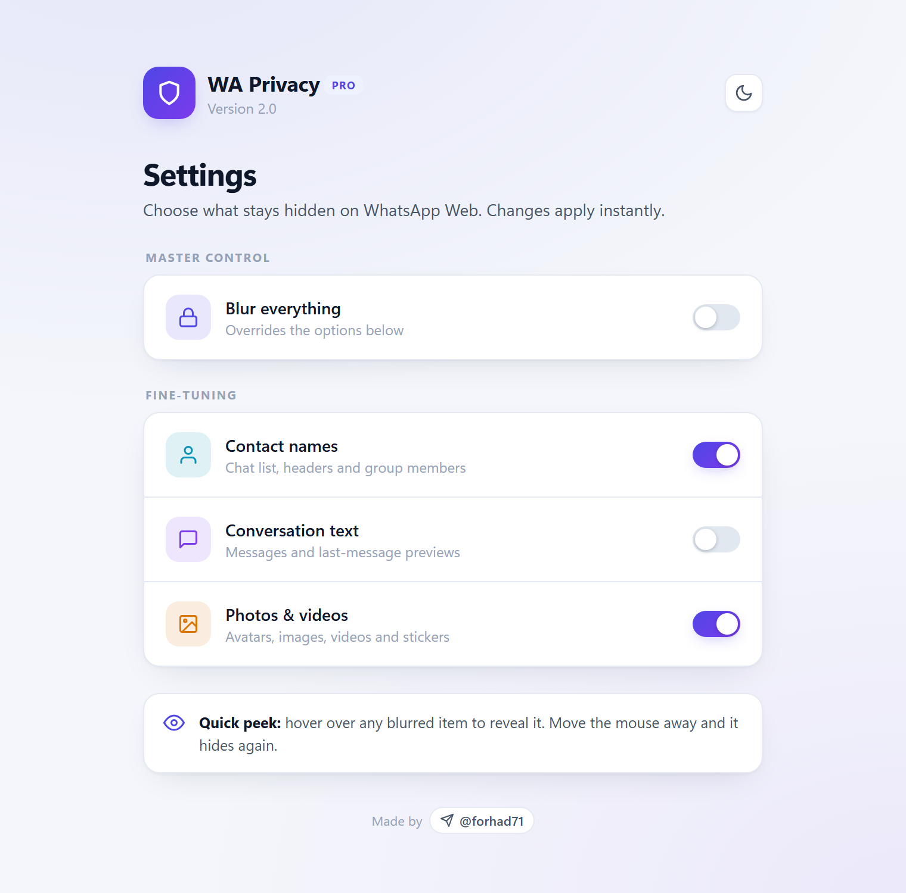
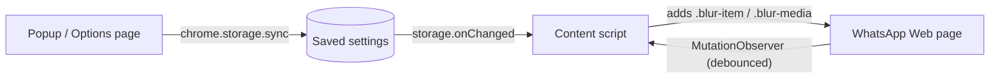

<div align="center">


# WA Privacy Pro

**Blur contact names, messages, photos and videos on WhatsApp Web. Hover to peek.**

A lightweight, privacy-first Chrome extension that keeps your chats safe from shoulder surfers,<br>
screen shares, and anyone looking over your shoulder in the office, café or classroom.

[](https://developer.chrome.com/docs/extensions/develop/migrate/what-is-mv3)
[](https://github.com/ForhadHossain71/whatsapp-web-privacy-blur/releases/latest)
[](LICENSE)
[](https://t.me/forhad71)

[**Download**](https://github.com/ForhadHossain71/whatsapp-web-privacy-blur/releases/latest) ·
[Install guide](#-installation) ·
[Report a bug](https://github.com/ForhadHossain71/whatsapp-web-privacy-blur/issues/new?template=bug_report.yml) ·
[Request a feature](https://github.com/ForhadHossain71/whatsapp-web-privacy-blur/issues/new?template=feature_request.yml)

<br>



</div>

---

## 📑 Table of contents

- [Features](#-features)
- [Screenshots](#-screenshots)
- [Installation](#-installation)
- [How to use](#-how-to-use)
- [How it works](#-how-it-works)
- [Privacy and permissions](#-privacy-and-permissions)
- [Browser support](#-browser-support)
- [Project structure](#-project-structure)
- [Troubleshooting](#-troubleshooting)
- [Roadmap](#-roadmap)
- [Contributing](#-contributing)
- [License](#-license)
- [Author](#-author)

## ✨ Features

| | Feature | Description |
|---|---|---|
| 🔒 | **One-click protection** | Blur everything on WhatsApp Web with a single button. |
| 🎚️ | **Fine-grained control** | Choose to blur only **contact names**, **conversation text**, or **photos & videos**. |
| 👀 | **Hover to peek** | Move your mouse over any blurred item to reveal it, then it hides again. |
| ⚡ | **Instant updates** | Settings apply live. No page reload needed. |
| 🌗 | **Light and dark themes** | A clean white interface by default, with a one-tap dark mode. |
| 🧭 | **Settings inside the popup** | Change everything from the toolbar popup without opening a new tab. |
| 🪶 | **Lightweight** | Plain JavaScript, no frameworks, no trackers, no external requests. |
| 🛡️ | **Privacy-first** | Your settings stay in your browser. Nothing is collected or sent anywhere. |

## 📸 Screenshots

<table>
  <tr>
    <td align="center"><br><sub><b>Protection off</b></sub></td>
    <td align="center"><br><sub><b>Partially protected</b></sub></td>
    <td align="center"><br><sub><b>Fully protected</b></sub></td>
  </tr>
  <tr>
    <td align="center"><br><sub><b>Settings inside the popup</b></sub></td>
    <td align="center"><br><sub><b>Dark mode</b></sub></td>
    <td align="center"><br><sub><b>Full options page</b></sub></td>
  </tr>
</table>

## 🚀 Installation

### Option 1: Download the release (recommended)

1. Go to the [**latest release**](https://github.com/ForhadHossain71/whatsapp-web-privacy-blur/releases/latest) and download `wa-privacy-pro-vX.Y.Z.zip`.
2. Unzip it to a folder you will keep (for example `Documents/wa-privacy-pro`).
3. Open `chrome://extensions` in your browser.
4. Turn on **Developer mode** (top-right corner).
5. Click **Load unpacked** and select the unzipped folder.
6. Pin **WA Privacy Pro** from the puzzle-piece menu so it is always one click away.

### Option 2: Clone from source

```bash
git clone https://github.com/ForhadHossain71/whatsapp-web-privacy-blur.git
```

Then follow steps 3 to 6 above and select the cloned `whatsapp-web-privacy-blur` folder.

> [!TIP]
> Using **Microsoft Edge**, **Brave** or **Opera**? Open `edge://extensions`, `brave://extensions` or `opera://extensions` instead. The steps are the same.

### Updating

Download the new release (or run `git pull`), then click the **↻ reload** icon on the extension card in `chrome://extensions`, and refresh your WhatsApp Web tab.

## 🧑‍💻 How to use

1. Open [web.whatsapp.com](https://web.whatsapp.com) and sign in as usual.
2. Click the **WA Privacy Pro** icon in your toolbar.
3. Press **Enable Blur** to hide everything, or tap the **Names / Messages / Media** tiles to blur only what you need.
4. Hover over anything blurred to take a quick look.
5. Click the ⚙️ gear for detailed settings, or the 🌙 moon to switch themes.

| Popup state | Meaning |
|---|---|
| 🛡️ **Protection off** | Nothing is blurred. |
| 🟠 **Partially protected** | Some categories are blurred. |
| 🟣 **You're protected** | Everything is blurred. |

## ⚙️ How it works



- The **content script** runs only on `web.whatsapp.com`. It finds names, messages and media and adds CSS blur classes to them.
- A debounced **MutationObserver** re-applies the blur as new chats and messages load.
- When you change a setting, `chrome.storage.onChanged` tells the page to update right away.
- Blur is pure CSS (`filter: blur()`), so hovering removes it with a smooth transition.

## 🔐 Privacy and permissions

WA Privacy Pro does **not** collect, store, or transmit any personal data. It never reads your messages for any purpose other than applying a visual blur in your own browser, and it makes **no network requests**.

| Permission | Why it is needed |
|---|---|
| `storage` | Saves your blur preferences (on/off switches) and syncs them across your Chrome profile. |
| `https://web.whatsapp.com/*` | Lets the extension apply blur styles on WhatsApp Web, and only there. |

Read the full [Privacy Policy](PRIVACY.md).

## 🌐 Browser support

| Browser | Supported |
|---|---|
| Google Chrome 111+ | ✅ |
| Microsoft Edge 111+ | ✅ |
| Brave | ✅ |
| Opera | ✅ |
| Firefox | ❌ Not yet (see [Roadmap](#-roadmap)) |

## 📁 Project structure

```text
whatsapp-web-privacy-blur/
├── manifest.json        # Extension manifest (MV3)
├── content.js           # Applies blur on WhatsApp Web
├── styles.css           # Blur and hover-to-reveal styles
├── popup.html / .js     # Toolbar popup with in-popup settings
├── options.html / .js   # Full-page settings
├── ui.css               # Shared design system (light and dark tokens)
├── theme.js             # Light/dark theme switcher
├── icons/               # Extension icons (16, 32, 48, 128 px + SVG source)
├── docs/screenshots/    # Images used in this README
└── .github/             # Issue templates, PR template and release workflow
```

## 🩺 Troubleshooting

<details>
<summary><b>Blur is not applied after installing</b></summary>

Refresh your WhatsApp Web tab once. Content scripts only load into pages opened after the extension was installed or reloaded.
</details>

<details>
<summary><b>Some names or messages are not blurred anymore</b></summary>

WhatsApp Web changes its internal page structure from time to time. Please [open a bug report](https://github.com/ForhadHossain71/whatsapp-web-privacy-blur/issues/new?template=bug_report.yml) with a short description of what is no longer blurred, and it will be fixed in the next release.
</details>

<details>
<summary><b>"Load unpacked" says the manifest file is missing</b></summary>

Make sure you selected the folder that directly contains `manifest.json`, not a parent folder or the `.zip` file itself.
</details>

<details>
<summary><b>The individual switches are greyed out</b></summary>

That is expected while **Blur everything** is on, because it overrides the individual options. Turn it off to choose categories one by one.
</details>

## 🗺️ Roadmap

- [x] Blur names, messages and media separately
- [x] Hover to peek
- [x] Settings inside the popup
- [x] Light and dark themes
- [ ] Keyboard shortcut to toggle blur
- [ ] Auto-blur when the window loses focus or after inactivity
- [ ] Adjustable blur strength
- [ ] Firefox support
- [ ] Chrome Web Store listing

Have an idea? [Request a feature](https://github.com/ForhadHossain71/whatsapp-web-privacy-blur/issues/new?template=feature_request.yml).

## 🤝 Contributing

Contributions, bug reports and ideas are very welcome. Please read the [Contributing Guide](CONTRIBUTING.md) before opening a pull request.

## 📄 License

Released under the [MIT License](LICENSE). Free to use, modify and share.

> [!NOTE]
> WA Privacy Pro is an independent project. It is not affiliated with, endorsed by, or sponsored by WhatsApp LLC or Meta Platforms, Inc. "WhatsApp" is a trademark of its respective owner.

## 👤 Author

**Forhad Hossain**

[](https://t.me/forhad71)
[](https://github.com/ForhadHossain71)

<div align="center">

<br>

**If WA Privacy Pro keeps your chats private, please give it a ⭐ on GitHub. It helps others find it.**

</div>
